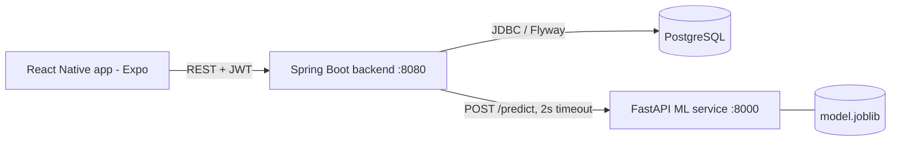

# Alba - MVP

Mobile app for early detection and follow-up of depressive symptoms in university students
(UNMSM, Lima) using the PHQ-9 questionnaire plus a Machine Learning risk classifier.

> **WARNING: all data is SYNTHETIC. No real student data was used. Model results are NOT
> clinically valid and the system is NOT a diagnostic tool.**

## Architecture



| Dir | Content |
|---|---|
| `ml/` | Synthetic dataset generator, 3-algorithm benchmark, notebook, exported model |
| `ml-service/` | FastAPI `/health`, `/predict` (loads `model/model.joblib`) |
| `backend/` | Spring Boot 3 / Java 21: JWT auth, assessments, psychoeducation |
| `app/` | Expo React Native (TypeScript) |
| `dataset.csv` | Generated synthetic dataset (2000 rows), ready to upload to Google Colab |
| `docker-compose.yml` | postgres + ml-service + backend |

## Synthetic data and the ML model

`ml/generate_dataset.py` (seed 42, 2000 rows). Features: 9 PHQ-9 items (0-3), age, sex,
semester, sleep hours, weekly study hours, part-time work, lives with family.

If the label were a deterministic function of the PHQ-9 sum, any model would score 100%.
Instead the target is derived from a latent severity:

```
severity = PHQ9_sum + 0.8*(7 - sleep) + 0.06*(study - 18) + 1.0*works
           + 1.2*(not family) + 0.15*(semester - 5) + N(0, 3.0)
risk_level = low (<9) | moderate (9-15) | high (>=15)
```

This was designed by us, not taken from the clinical literature: the models only learn the
rule we wrote. Scores below show the benchmark works; they say nothing about real students.

### Benchmark (20% stratified hold-out, n=400; 5-fold CV on the train split)

| Model | Accuracy | Macro F1 | Macro AUC (OvR) | Recall (high) | CV macro F1 |
|---|---|---|---|---|---|
| Logistic Regression | 0.775 | 0.745 | 0.895 | 0.656 | 0.729 |
| Random Forest | 0.745 | 0.707 | 0.869 | 0.547 | 0.687 |
| XGBoost | 0.745 | 0.700 | 0.874 | 0.609 | 0.693 |

Winner by macro F1 (tie-break AUC): **Logistic Regression**. This is expected, since the
synthetic generator is nearly linear. Full numbers and confusion matrices:
`ml/results/metrics.json`, plot: `ml/results/comparison.png`.

### Run the benchmark

```bash
cd ml
uv sync
uv run python generate_dataset.py     # writes ../dataset.csv
uv run python train_benchmark.py      # reads ../dataset.csv (generates it if absent)
                                      # -> results/metrics.json, results/comparison.png,
                                      #    model/model.joblib, model/model_meta.json
uv run python build_notebook.py       # regenerates benchmark.ipynb
cp model/model.joblib model/model_meta.json ../ml-service/model/   # deploy the model
```

### Google Colab

Open `ml/benchmark.ipynb` in Colab and upload `dataset.csv` (Files panel) to the working
directory. The notebook is self-contained: it installs `xgboost` if missing, loads
`dataset.csv` from the working directory and falls back to generating the data inline
if the file is absent. It shows the comparison table and plots inline.

## API contract

All backend JSON is camelCase; the ML service JSON is snake_case. Auth: `Authorization: Bearer <jwt>`.

**ML service**

- `GET /health` -> `{"status":"ok","model":"LogisticRegression"}`
- `POST /predict`
  ```json
  {"phq1":0,"phq2":1,"phq3":2,"phq4":1,"phq5":0,"phq6":1,"phq7":0,"phq8":0,"phq9":0,
   "age":21,"sex":"F","semester":5,"sleep_hours":6.5,"weekly_study_hours":20,
   "works_part_time":false,"lives_with_family":true}
  ```
  -> `{"risk_level":"low|moderate|high","probabilities":{"low":0.8,"moderate":0.15,"high":0.05},"model":"..."}`
  Items must be 0-3 (otherwise 422).

**Backend**

| Method / path | Auth | Body | Response |
|---|---|---|---|
| `POST /api/auth/register` | no | `{email,password(>=8),fullName,consent:true}` | `{token,userId,email,fullName}` (201; 409 duplicate) |
| `POST /api/auth/login` | no | `{email,password}` | same as above (401 invalid) |
| `POST /api/assessments` | yes | `{answers:[9 ints 0-3],age,sex:"F"/"M",semester,sleepHours,weeklyStudyHours,worksPartTime,livesWithFamily}` | Assessment (201) |
| `GET /api/assessments` | yes | - | Assessment[] newest first |
| `GET /api/psychoeducation?risk=low\|moderate\|high` | yes | - | `[{id,title,body,riskLevels}]` |

Assessment: `{id,createdAt,answers,totalScore(0-27),severityLevel(MINIMAL|MILD|MODERATE|MODERATELY_SEVERE|SEVERE),
suicideAlert,referralRecommended,mlAvailable,mlRiskLevel,mlProbabilities,mlModel,alertMessage}`

Rules: severity cut points 0-4 / 5-9 / 10-14 / 15-19 / 20-27. `suicideAlert = item 9 > 0`
regardless of total. `referralRecommended = suicideAlert || SEVERE`. If the ML service is
down or slower than 2 s, the assessment is still saved and returned with `mlAvailable=false`
and `mlRiskLevel=null` (graceful fallback: PHQ-9 scoring only).

## How to run

### Everything with Docker

```bash
cp .env.example .env     # edit secrets
docker compose up --build
curl localhost:8000/health ; curl localhost:8080/actuator/health
```

### Parts individually

```bash
# ML service
cd ml-service && uv sync && uv run pytest && uv run uvicorn app.main:app --port 8000

# Backend (needs PostgreSQL; defaults in application.yml, override with DB_URL, DB_USER, DB_PASSWORD, ML_SERVICE_URL, JWT_SECRET)
cd backend && mvn test && mvn spring-boot:run

# App
cd app && npm install && cp .env.example .env   # set EXPO_PUBLIC_API_URL
npx expo start          # or: npm run web / npm run android
npm run typecheck
```

On an Android emulator use `EXPO_PUBLIC_API_URL=http://10.0.2.2:8080`; on a physical device use the LAN IP of the host.

### App design system (`app/src/ui/`)

- **Tokens** (`tokens.ts`): cool-mist canvas, lagoon-teal primary, lavender for "supportive info" (ML estimate), warm plum for the suicide-ideation card (never red). PHQ-9 severity levels use five soft tints (sage, sky, sand, apricot, plum). Text/background pairs are >= 4.5:1. Nunito (via `@expo-google-fonts`) with a system-font fallback; spacing, radius and shadow scales live in the same file.
- **Primitives**: `Screen`, `Text`, `Button`, `Card`, `Chip`/`Tag`, `ProgressBar`, `Field`, `Reveal`, `Pressable`, `Sunrise`, and `LoadingState`/`ErrorState`/`EmptyState`.
- **Motion** (Reanimated, UI thread): press scale 0.97 (120 ms), animated progress, staggered entrance, step slide in the questionnaire, light haptics on answer select/submit.
- **Degradation**: with the OS "reduce motion" setting, translation/scale are dropped (fade only) and stack transitions become a cross-fade. Haptics are native-only; on web they are skipped (and wrapped in try/catch), and every haptic is paired with a visual change.
- Reanimated 3 needs `react-native-reanimated/plugin` in `app/babel.config.js` (required on web too); after changing it start with `npx expo start --clear`.

## Known limitations

- Synthetic data; model metrics are not evidence of clinical validity. Real validation needs
  real, ethically approved data and clinician-defined labels.
- PHQ-9 is a screening tool, not a diagnosis. Item-9 handling is a static message with the Peruvian
  helpline (Linea 113, option 5); there is no clinician notification workflow.
- Not implemented from the RF/RNF list: RF07 is a simple bar chart, RF09 (PDF export), Prometheus/Grafana (RNF07),
  encryption at rest (RNF01), SUS evaluation. Consent is a registered boolean + timestamp only.
- Sociodemographic fields are re-asked in every assessment (no user profile).
- CORS is open (`*`) and the JWT secret defaults to a dev value: dev only.
- Spanish PHQ-9 wording is the generic official version; the project still must fix a single
  version (see `documentos/phq-9-cuestionario-oficial.typ`).
- No login rate limiting, refresh tokens, or password reset. Backend has unit tests for scoring only
  (no integration tests against a database).

## Demo script (10 minutes)

1. (1 min) Problem and architecture diagram; state clearly the data is synthetic.
2. (2 min) `ml/results/comparison.png` and the table above: 3 algorithms, macro F1 selection, why not 100%.
3. (1 min) `docker compose up`; show `/health` of both services.
4. (1 min) App: register (consent), login.
5. (2 min) PHQ-9 form: answer a moderate profile, show progress bar and the result (score, level, ML risk).
6. (1 min) Repeat with item 9 = 1 and low total: alert and referral message appear regardless of score.
7. (1 min) History list and trend chart, then psychoeducation filtered by risk.
8. (1 min) Stop `ml-service` (`docker compose stop ml-service`), submit again: graceful fallback with PHQ-9 only.
